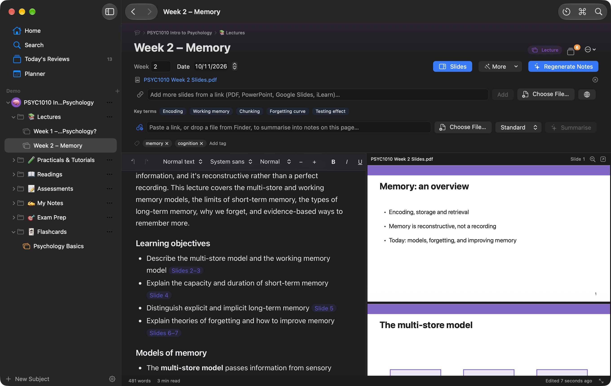
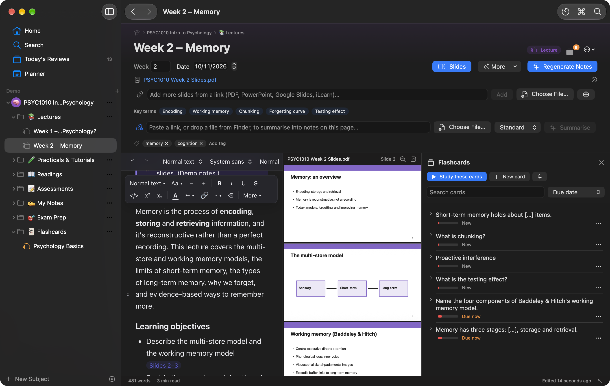
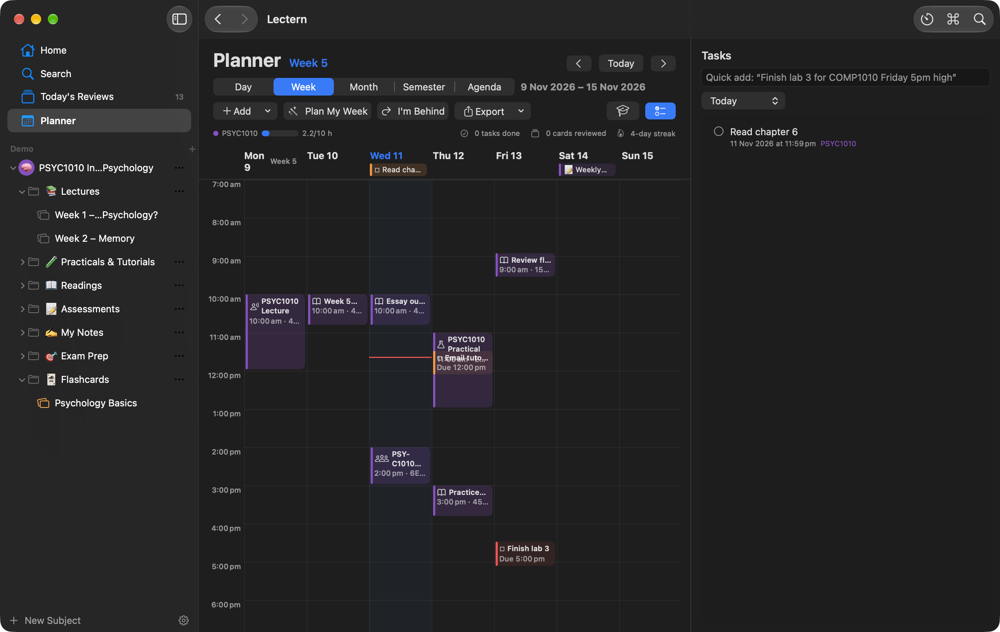
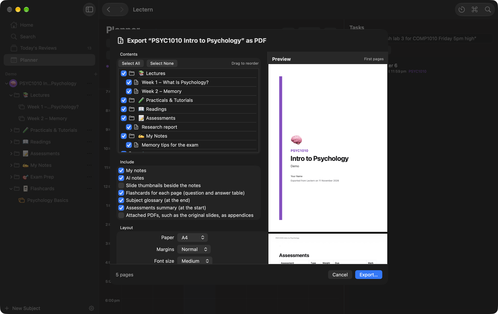
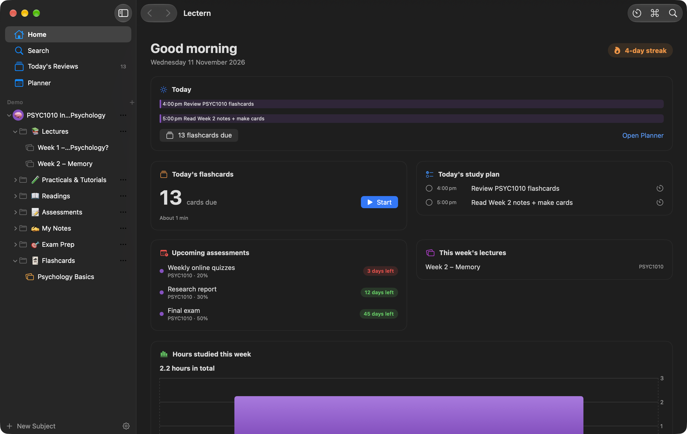
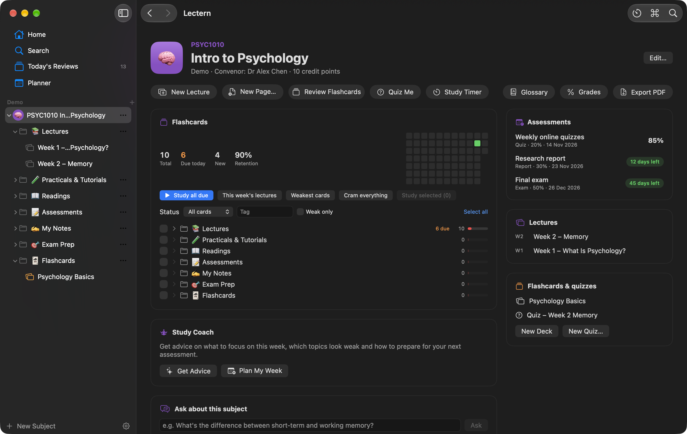
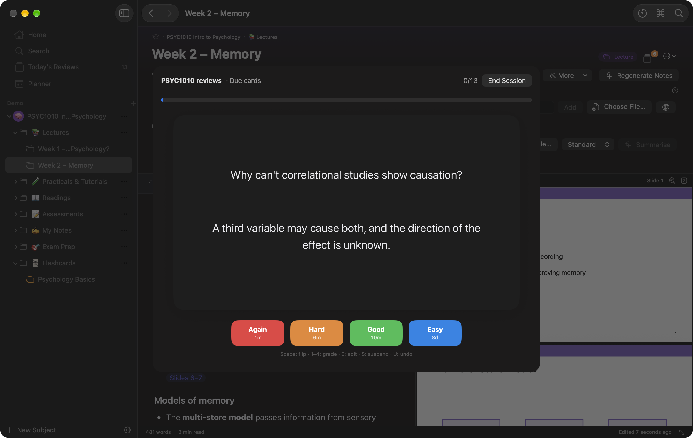

# Lectern

**Your whole degree in one calm place.**
Organise every subject, turn lecture slides into great notes automatically, write your own, study with flashcards
and quizzes, plan your week and get advice for each subject. Everything is saved as normal files in a folder you choose.

  

## Screenshots
| The new editor and a page's flashcards | Planner week view | Export a subject as one PDF |
| --- | --- | --- |
|  |  |  |

| Home dashboard | A subject, with its Flashcards section | Flashcard review |
| --- | --- | --- |
|  |  |  |

## Features
- **Slides → notes, any length.** Paste a link to a PDF, PowerPoint, Word file, web page or Google Slides, sign in to iLearn once in Lectern's built-in browser, or just drop the file in. Lectern reads every slide in sections and writes structured notes: an overview, learning objectives, topic notes with clickable **slide citations**, diagrams explained, key terms, a summary, likely exam questions and things to ask your lecturer. A coverage report shows every slide was covered, and lists any that weren't. It runs in the background and can resume if it's interrupted.
- **Claude or free local models.** Use your own Claude key, or Ollama on your Mac. The Model advisor recommends the best installed model for your Mac, and you can choose a different model for each task.
- **Slides beside your notes.** Click a slide to see which notes came from it, or click a citation to jump to the slide.
- **An editor like Notion and Google Docs.** Select text for a formatting menu (type, size, colour, highlight, alignment, links, AI). An optional toolbar, drag handles on every block, and a “/” menu with tables, toggles, callouts, columns, code, maths (KaTeX), dates and a table of contents. Pages stay Markdown, so they open in any editor.
- **Flashcards that stick.** Rich-text basic, reversible, cloze and image-occlusion cards scheduled with **FSRS**, the modern spaced-repetition algorithm. Every page has its own cards beside your notes, and each subject shows them all by folder, with strength, due counts and “Study selected”. Daily reviews, cram and weak-card modes, stats, CSV and Anki export.
- **Quizzes and practice exams** from any page, folder or subject, with written answers marked against your notes.
- **Study Coach** for every subject: what to focus on this week, weak topics, how to prepare for the next assessment, techniques that work, and “Plan my week”. **Ask about this subject** answers from your own notes and slides, with sources.
- **A planner built for semesters.** Week numbers (Macquarie's dates built in), your class timetable with .ics import, tasks with natural-language quick add, assessment milestones, **Plan My Week**, an “I'm behind” catch-up, exam revision plans, Day, Week, Month, Semester and Agenda views, reminders, and optional Apple Calendar and Reminders sync.
- **Timer and grades:** a Pomodoro timer in the menu bar that logs study time, and a grade calculator with HD/D/Cr/P/F bands.
- **Find anything:** instant search across pages, slide text, recording transcripts and flashcards, plus a command palette (⇧⌘P).
- **Yours, as files:** subjects are folders and pages are Markdown, in a University folder you choose. Put it in iCloud Drive or OneDrive for automatic backup. Version history keeps 50 versions of every page, and deleted items go to the Trash.
- Lecture recordings can be **transcribed on your Mac** and used with the slides (for personal study only, per your university's rules).
- **Export a whole subject or folder as one PDF** with a cover, contents, bookmarks and page numbers; or export Markdown or HTML, print, or make a **study guide** PDF. Light and dark mode, keyboard shortcuts for everything, and VoiceOver labels throughout.

## Requirements
- A Mac with Apple Silicon (M1 or later)
- macOS 14 Sonoma or later
- AI features need either your own Claude API key from [platform.claude.com](https://platform.claude.com) (a lecture's notes usually cost a few cents) or [Ollama](https://ollama.com) (free, runs on your Mac). Everything else works without AI, and offline.

## Install
1. [Download Lectern.dmg](https://github.com/MilkshakeSR/Lectern/releases/latest/download/Lectern.dmg) and open it.
2. Drag **Lectern** into **Applications**.
3. The first time, **right-click Lectern and choose Open**, then click **Open** again. Lectern isn't notarized by Apple, so macOS asks once.
4. The welcome screens help you choose your University folder, add a subject and (optionally) your Claude API key.

## Updates
Lectern checks for updates once a day and tells you when a new version is ready. You can also choose
**Lectern → Check for Updates…**, or turn on automatic installs in **Settings → Updates**.

## Privacy
Your notes, flashcards and quizzes stay in your University folder; the search index and page history stay on your Mac.
**With Claude, only the content used for an AI action is sent to Anthropic, and only when you click it** (for example, a lecture's slides when you click Generate Notes), using your own API key, which is kept in your Keychain. With Ollama on your Mac, nothing leaves your Mac.
Recordings are transcribed on-device. There are no analytics or tracking. Lectern also contacts the sites of links you paste, and GitHub to check for updates.

**Academic integrity:** Lectern is for learning. It explains, quizzes and gives feedback, but won't write your assessments.

## Report a problem
Choose **Help → Report a Problem…** in Lectern, or [open an issue](https://github.com/MilkshakeSR/Lectern/issues/new).

## Version history
See [all releases](https://github.com/MilkshakeSR/Lectern/releases).
